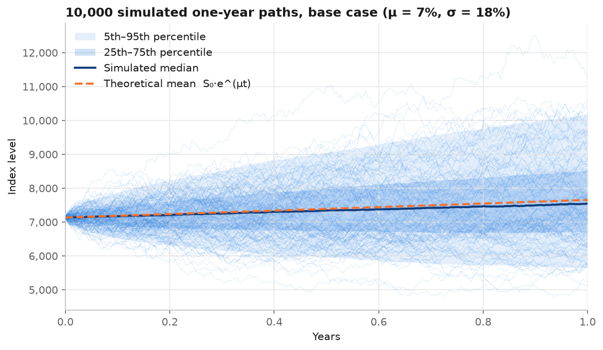
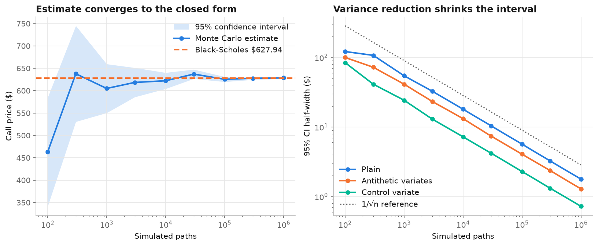
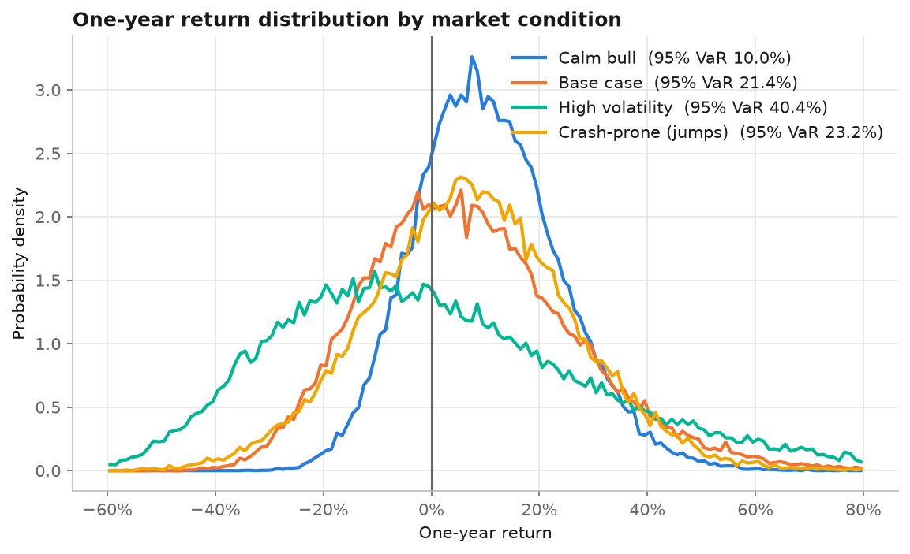
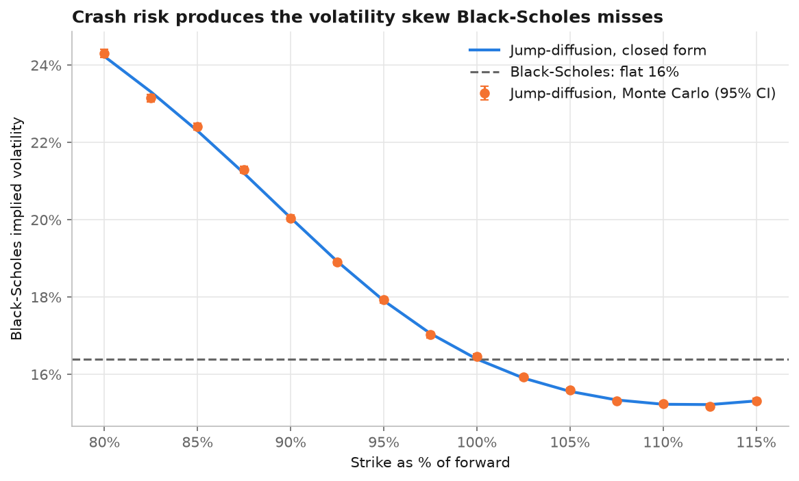
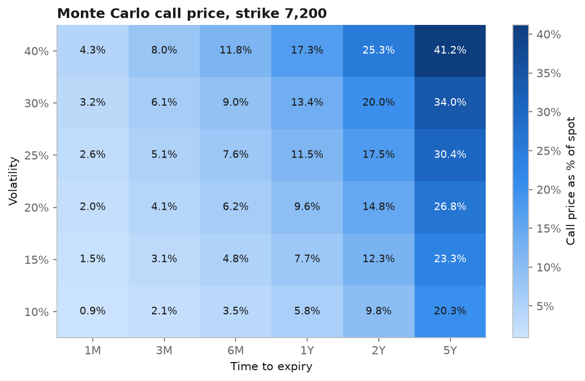
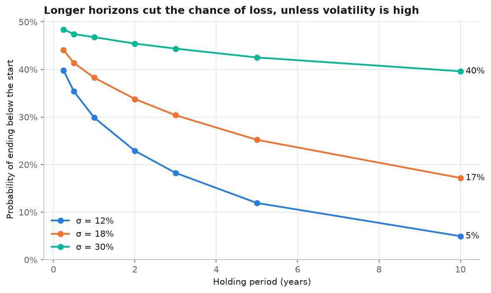

# Monte Carlo Financial Simulation

A Python Monte Carlo engine that simulates thousands of S&P 500 price paths under **geometric Brownian motion** and **jump-diffusion**, measures the resulting return distributions under different market conditions, and prices options with **confidence intervals** and **variance reduction**. Every result is checked against a closed-form answer.

> **Question:** If you simulate the market instead of solving it on paper, how close do you get to the right answer, how fast does the error shrink, and what can simulation tell you that a single formula can't?

This is Project 2 of my quant portfolio. It starts from the same SPX snapshot as [Project 1: Black-Scholes Options Pricing Model](https://github.com/Siiirrreee/options-pricing-model), reprices that project's real contract by simulation, and then explains the volatility skew Project 1 found.



## What it does

| Step | Detail |
|---|---|
| Path simulation | Exact log-space GBM (no discretisation error) and Merton jump-diffusion, vectorised in NumPy |
| Market conditions | Calm bull, base case, high volatility, and a crash-prone regime with the **same mean and volatility** as the base case |
| Distributions | Expected vs. median return, percentiles, probability of loss, 95% VaR and CVaR, maximum drawdown along each path |
| Option pricing | European calls/puts with 95% confidence intervals; arithmetic Asian options, which have no closed form |
| Variance reduction | Antithetic variates, a terminal-price control variate, and a geometric-Asian control variate |
| Validation | Simulated moments vs. GBM theory, prices vs. Black-Scholes and Merton closed forms, CI coverage |
| Sensitivity | Option price across a 6 × 6 volatility × maturity grid; probability of loss across 3-month to 10-year horizons |
| Output | CSV tables, `stats.json`, a written summary, and six charts |

## Results

<!-- RESULTS:START -->
_S&P 500 starting level 7,136, r = 4.2%, seed 42. All prices are risk-neutral; scenario drifts are illustrative assumptions. Full detail in [results/summary.md](results/summary.md)._

**Market check: pricing the real SPX contract from the options project**

| Contract | Market mid | Black-Scholes | Monte Carlo (95% CI) | Paths |
|:--|--:|--:|--:|--:|
| SPX Dec-18 7,200 call, σ = 23.4% | 150.35 | 150.16 | 150.19 (149.94–150.44) | 1,000,000 |

**One-year outcomes under four market conditions**

| Scenario            | μ / total σ          | Expected return   | Median return   | 5th–95th pct   | P(loss)   | 95% VaR   | 95% CVaR   | Median max drawdown   |
|:--------------------|:---------------------|:------------------|:----------------|:---------------|:----------|:----------|:-----------|:----------------------|
| Calm bull           | 10% / 12%            | 10.5%             | 9.6%            | -10% to +33%   | 22.0%     | 10.0%     | 14.4%      | 9.5%                  |
| Base case           | 7% / 18%             | 7.3%              | 5.6%            | -21% to +42%   | 38.3%     | 21.4%     | 26.9%      | 15.9%                 |
| High volatility     | 2% / 30%             | 1.9%              | -2.4%           | -40% to +60%   | 53.3%     | 40.4%     | 47.3%      | 28.3%                 |
| Crash-prone (jumps) | 7% / 18% incl. jumps | 7.3%              | 7.0%            | -23% to +38%   | 34.7%     | 23.2%     | 30.9%      | 12.9%                 |

**Convergence: 1-year 7,200 call, σ = 18%, 1,000,000 paths (Black-Scholes $627.94)**

| Estimator           |   Price |   Std. error |   Error vs BS | Variance reduction   |
|:--------------------|--------:|-------------:|--------------:|:---------------------|
| Plain               |  628.59 |        0.91  |         0.649 | 1.0×                 |
| Antithetic variates |  627.73 |        0.658 |         0.202 | 1.9×                 |
| Control variate     |  627.83 |        0.37  |         0.11  | 6.1×                 |

**Probability of losing money by holding period (μ = 7%)**

| Horizon   | P(loss), σ = 12%   | P(loss), σ = 18%   | P(loss), σ = 30%   |
|:----------|:-------------------|:-------------------|:-------------------|
| 1 yr      | 29.9%              | 38.3%              | 46.8%              |
| 5 yr      | 11.9%              | 25.2%              | 42.5%              |
| 10 yr     | 5.0%               | 17.2%              | 39.6%              |

**Key findings**

- The simulation reproduces the closed form: the Monte Carlo price of the SPX Dec-18 7,200 call is **$150.19** against Black-Scholes $150.16 and a market mid of $150.35. Across the convergence study, the 95% interval contained the exact price in **93%** of 27 runs (in line with the 95% nominal rate), and across the 36-cell volatility × maturity grid in **100%**.
- Error shrinks at the textbook 1/√n rate: 100× more paths buys only 10× more precision. Variance reduction is cheaper: the control variate cut variance **6.1×** and antithetic variates **1.9×**, equivalent to running that many times more paths.
- In the base case (μ = 7%, σ = 18%) the expected one-year return is **7.3%**, but the median is lower at 5.6%: lognormal returns are right-skewed, so the average is pulled up by a few large winners. There is a **38%** chance of ending the year down.
- The crash-prone scenario has the **same expected return and the same 18% total volatility** as the base case, yet a fatter left tail: 95% CVaR rises from 26.9% to **30.9%** and the chance of losing more than 20% goes from 6.1% to 7.0%. Ordinary years are actually calmer (P(loss) 34.7% vs 38.3%): the risk is concentrated in rare crashes. Volatility alone understates risk when moves come in jumps. The high-volatility regime is worst on every risk measure (P(loss) 53%, CVaR 47.3%).
- Time diversifies volatility only partly: at σ = 18% the chance of a loss falls from 38% over 1 year to 17% over 10, while at σ = 30% it barely moves (47% → 40%), because the volatility drag σ²/2 eats most of a 7% drift.
- An arithmetic-average Asian call, which has no closed form, prices at **$334.31** vs $627.94 for the European: averaging dampens volatility. Using the geometric Asian as a control variate cut variance **1,548×**.
- Adding jumps explains the skew found in the options project: priced under the crash-prone model, 3-month options show implied volatility of **24.2%** at the 80% strike, 16.4% at the money and 15.3% at 115%, a downward-sloping skew that a single Black-Scholes volatility cannot produce.
<!-- RESULTS:END -->







| Option price vs. volatility and time | Probability of loss vs. horizon |
|---|---|
|  |  |

## How it works

**Geometric Brownian motion.** The price follows $dS = (\mu - q)S\,dt + \sigma S\,dW$. Its solution is known exactly, so each step is simulated without approximation:

$$S_{t+\Delta t} = S_t \exp\!\Big[\big(\mu - q - \tfrac{1}{2}\sigma^2\big)\Delta t + \sigma\sqrt{\Delta t}\,Z\Big], \qquad Z \sim N(0,1)$$

The $-\tfrac{1}{2}\sigma^2$ term is why the median return sits below the mean, and why high volatility can wipe out a positive drift over long horizons.

**Monte Carlo pricing.** Under the risk-neutral measure the asset drifts at $r - q$, and an option is worth its discounted expected payoff. With $n$ simulated payoffs $X_i$:

$$\hat V = \frac{1}{n}\sum_{i=1}^{n} e^{-rT} X_i, \qquad \text{95\% CI} = \hat V \pm 1.96\,\frac{s}{\sqrt n}$$

The interval narrows at $1/\sqrt n$: 100× more paths buys only 10× more precision. Variance reduction lowers $s$ instead:

- **Antithetic variates** pair every draw $Z$ with $-Z$. The pair average is one sample, so the standard error accounts for the pairing.
- **Control variate.** The discounted terminal price $e^{-rT}S_T$ has known mean $S_0e^{-qT}$. The estimator $X - \beta\,(Y - E[Y])$ with fitted $\beta$ removes the part of the payoff noise explained by $Y$.
- **Asian options** use the geometric-average Asian as the control. It has a closed form and moves almost one-for-one with the arithmetic average.

**Jump-diffusion (Merton 1976)** adds Poisson-arriving lognormal jumps, $dS/S = (\mu - q - \lambda k)\,dt + \sigma\,dW + (J-1)\,dN$. The $-\lambda k$ term keeps the expected return unchanged. The crash-prone scenario uses about one jump a year averaging −8%, with the diffusion volatility lowered so total volatility stays at 18%. Same mean, same volatility, different tail. Monte Carlo prices are checked against Merton's closed-form series, then inverted to Black-Scholes implied volatility to show the skew.

**Calibration.** Starting level 7,136 is the SPX spot implied by the put-call-parity forward in Project 1 (F = 7,155.7, 24 days, r = 4.2%). The market check uses that project's 7,200 call at its 23.4% implied volatility. Scenario drifts and volatilities are illustrative assumptions, not forecasts.

## Project structure

```
├── main.py                      # runs the full pipeline (CLI)
├── src/monte_carlo/
│   ├── paths.py                 # GBM and Merton jump-diffusion path simulation
│   ├── scenarios.py             # market conditions and SPX calibration
│   ├── analytics.py             # distribution stats, VaR/CVaR, drawdowns, GBM theory
│   ├── pricing.py               # MC pricing, CIs, variance reduction, closed forms
│   ├── sensitivity.py           # volatility x maturity and horizon studies
│   └── visuals.py               # Matplotlib charts
├── notebooks/                   # step-by-step walkthrough
├── tests/                       # pytest: moments vs theory, MC vs closed forms, CI coverage, parity
├── results/                     # CSV tables, stats.json, summary.md
└── visuals/                     # charts used in this README
```

A GitHub Actions workflow runs the tests and the full pipeline on every push and commits the refreshed results and charts.

## Run it

```bash
python -m venv .venv
# Windows: .venv\Scripts\activate    macOS/Linux: source .venv/bin/activate
pip install -r requirements.txt
python main.py                 # full run, about 10 seconds
python main.py --paths 50000   # quicker run
python main.py --seed 7        # different random draws
python -m pytest               # run the tests
```

Use the engine directly:

```python
import sys; sys.path.insert(0, "src")
from monte_carlo import simulate_gbm, mc_european, mc_asian, distribution_stats

times, paths = simulate_gbm(S0=7136, mu=0.07, sigma=0.18, T=1, n_steps=252, n_paths=10_000, seed=1)
distribution_stats(paths[:, -1], S0=7136, T=1)          # expected return, P(loss), VaR, CVaR...

res = mc_european(S0=7136, K=7200, T=24/365, r=0.042, sigma=0.234,
                  n_paths=1_000_000, method="control", seed=1)
res.price, res.ci_low, res.ci_high                       # price with 95% CI

mc_asian(S0=7136, K=7200, T=1, r=0.042, sigma=0.18)      # path-dependent option
```

## Limitations

- **Constant parameters.** Volatility, drift and rates are fixed over each run. Real volatility clusters and mean-reverts (stochastic-volatility and GARCH models address this; see Project 5).
- **Illustrative scenarios.** Scenario drifts and volatilities are assumptions chosen to represent regimes, not estimates from data or forecasts.
- **Jump parameters are not calibrated.** The crash-prone model reproduces the *shape* of the SPX skew from Project 1, not its exact level. Fitting λ, jump mean and jump size to the option chain is a natural extension.
- **European and Asian payoffs only.** American exercise needs regression-based methods (Longstaff-Schwartz) on top of simulation.
- **Pseudo-random draws.** Quasi-random (Sobol) sequences would converge faster than 1/√n for smooth payoffs.

## Next steps

- Calibrate the jump-diffusion to the Project 1 SPX option chain and compare the fitted smile to the market
- Longstaff-Schwartz Monte Carlo for American options
- Heston stochastic volatility and quasi-Monte Carlo (Sobol) convergence
- C++ port of the path engine and a speed comparison against NumPy
- Multi-asset correlated simulation (Cholesky) feeding the portfolio optimizer and the risk model in Project 5

## Tech

Python · NumPy · SciPy · pandas · Matplotlib · pytest · GitHub Actions

---
*Educational project, not investment advice. Simulated outcomes depend entirely on the assumed model and parameters.*
